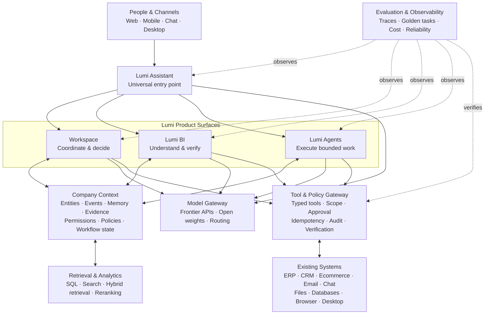
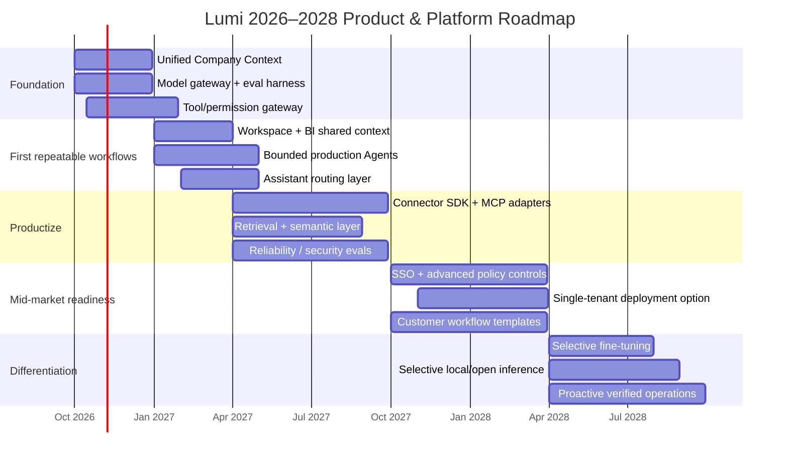

# Lumi AI Operating Stack and Roadmap, 2026–2028

## English — Executive summary

### Recommendation

**Lumi should build one AI operating system for a company, not four separate AI products.**

The coherent product architecture is:

**Assistant = entry point → Workspace = human operating surface → BI = understanding/evidence → Agents = bounded execution → Company Context = shared memory, permissions, provenance and workflow state → existing business software = systems of record.**

That architecture is already implicit in Lumi’s canonical design documents. The landing system explicitly says Assistant is the universal front door, Workspace coordinates people/decisions/commitments, BI traces conclusions to evidence, Agents execute bounded jobs with worklogs and approvals, and all four sit on one Company Context rather than becoming separate product islands. fileciteturn4file0 The deeper Lumi design contract also requires evidence, freshness, limits, human judgment, inspectable execution, and an explicit distinction among planned, attempted, executed and verified work. fileciteturn1file0 fileciteturn0file0

My recommended technical strategy is therefore **Balanced Hybrid**:

> **Use the best hosted frontier models, own the context/action/evaluation layers, selectively self-host small or specialized models, and fine-tune only where Lumi’s own evaluation data proves that it beats retrieval + prompting.**

Do **not** make owning a foundation model a 2026–2028 objective. Model capability and model names are changing too quickly: Anthropic has repeatedly retired model generations during 2026, OpenAI has already replaced its Assistants API with Responses, and providers increasingly expose comparable tool-use, structured-output and MCP-style capabilities. citeturn16search21turn17search5turn18search0 The durable asset is therefore not a model endpoint. It is Lumi’s **permission-aware Company Context, integration graph, workflow definitions, verified execution history, evaluation corpus and customer operating memory**.

The most important architectural separation is:

> **Models reason. Lumi decides what they may know, what they may do, whether it actually happened, and what evidence is preserved.**

That is the basis for a defensible product.

### Explicit assumptions

| Question | Working assumption for this report | Consequence |
|---|---|---|
| Primary customer | **SMEs + mid-market**, initially operator/founder-led organizations | Optimize for fast deployment and existing SaaS, not Fortune-500 transformation programs |
| Geography | Vietnam / Southeast Asia first, broader international markets later | Multilingual models, regional hosting options, local integration priorities |
| Typical customer | 20–500 employees, fragmented SaaS + spreadsheets + chat | Integration and context quality matter more than replacing systems |
| Buyer | CEO/founder/COO/head of function | Value must be visible in days or weeks |
| Deployment | Multi-tenant cloud by default; single-tenant/VPC as an upsell | Keep infrastructure economical without closing enterprise path |
| Data | Mixture of databases, SaaS APIs, spreadsheets, files, messages and browser-only systems | Structured and unstructured retrieval both required |
| Product strategy | One platform, multiple operating surfaces | Shared context, identity, policy and eval systems are mandatory |
| Team | Strong software/AI engineering, not a hyperscaler-scale ML research team | Buy frontier inference; own application intelligence |
| Commercial strategy | Founder-led pilots before heavy sales organization | Build around measurable workflows rather than generic platform demos |
| Compliance | Exact regulated sectors are **unspecified** | Build audit/privacy/security foundations now; pursue certifications when pipeline warrants them |
| Availability target | Serious business SaaS, but not initially safety-critical infrastructure | Strong SRE and recovery, without premature hyperscale architecture |

These assumptions should be treated as planning premises, not established facts.

### The strategic thesis for 2026–2028

The most important near-term trends point in the same direction.

**Models become more interchangeable; context and actions become more valuable.** OpenAI, Anthropic and Mistral all expose structured tool use, while MCP is spreading across Anthropic, OpenAI, Mistral and enterprise platforms such as Palantir. citeturn18search0turn18search4turn3search0turn4search10 Vercel’s AI Gateway is explicitly organized around model routing, fallback, spend and observability rather than one model provider. citeturn0search10

**Long context does not eliminate retrieval.** Research has shown that models can use long contexts unevenly; retrieval research since 2023 has instead moved toward adaptive retrieval, retrieval correction, hierarchy and reranking. Self-RAG retrieves when needed, CRAG evaluates retrieval quality, RAPTOR adds hierarchical summaries, and “Lost in the Middle” demonstrates why simply stuffing everything into a long context is not equivalent to reliable recall. citeturn11academia0turn12academia39turn12academia36turn12academia37

**Agents are progressing rapidly but remain much less reliable than demos suggest.** τ-bench found severe consistency loss when function-calling agents were required to complete real policy-bound tasks repeatedly; ToolSandbox found state dependencies and insufficient-information cases challenging; AgentDojo demonstrated that untrusted tool output creates prompt-injection risk. citeturn15academia24turn14academia49turn15academia26 As recently as 2026, WindowsWorld reported below-21% success for tested computer-use agents on complex cross-application workflows. citeturn13academia0

So the future-proof bet is **not maximum autonomy**.

It is:

> **Maximum useful autonomy inside explicit boundaries, with evidence and verification.**

That fits Lumi’s brand unusually well.

**Confidence: ~88%.** I am highly confident about the architectural direction and product unification. I am less confident about the precise infrastructure choices beyond 12–18 months because customer scale, regulated-industry demand and actual integration workloads are still unspecified.

## English — Product architecture and the Lumi operating stack

The mistake to avoid is turning the current portfolio into:

```text
Workspace SaaS
BI SaaS
Agents SaaS
Assistant SaaS
```

That creates four roadmaps, four mental models, duplicate context, duplicate permissions and weak cross-product effects.

The more coherent interpretation is:

| Layer | Lumi product | Job |
|---|---|---|
| Interaction | **Lumi Assistant** | “Tell Lumi what I need.” |
| Human operating surface | **Lumi AI Workspace** | “What matters, who owns it, what needs a decision?” |
| Understanding | **Lumi BI** | “What is happening, why, and what evidence supports it?” |
| Execution | **Lumi Agents** | “Carry out this bounded job and show me what happened.” |
| Shared substrate | **Lumi Company Context** | Identity, entities, memory, provenance, policies, permissions, workflows, audit |
| Action boundary | **Lumi Tool Gateway** | Safe, typed, policy-controlled access to customer systems |
| Systems of record | Existing software | ERP, CRM, ecommerce, chat, email, databases, files, browser/desktop apps |

This directly implements the current Lumi landing contract instead of inventing a second product strategy. fileciteturn4file0



**The critical architectural insight is that Company Context is not “a vector database.”**

It should contain at least four distinct kinds of memory:

| Memory type | Examples | Canonical implementation |
|---|---|---|
| Business facts | order, invoice, lead, customer, inventory quantity | Source record or normalized relational entity |
| Event memory | order paid, lead changed stage, user approved refund | Immutable/auditable event log |
| Knowledge | policy, SOP, proposal, email, PDF, notes | Object/document storage + retrieval index + provenance |
| Derived memory | summaries, risks, inferred preferences, operating briefs | Versioned derived records with source links and freshness |

A vector index is only an **access path** into some of this information. It must never become the source of truth.

### Workspace

Workspace should be the **human judgment layer**, not “ChatGPT with company data.”

Its durable primitives should be things such as:

**Signal → evidence → owner → decision → commitment → outcome.**

The canonical Lumi UX already requires the user to see source, freshness and limits before relying on a signal. fileciteturn1file0 That requirement should be implemented in the backend data model rather than painted onto the interface later.

Every surfaced signal should therefore be able to answer:

```text
What is claimed?
Which records support it?
When were they observed?
Which transformation produced it?
Which model/version participated?
How certain is the derived conclusion?
Who confirmed or rejected it?
Has the underlying state changed since?
```

### Lumi BI

Lumi BI should **not** primarily be a conversational RAG system.

For numbers, use:

> **semantic definitions → deterministic query/calculation → model explanation**

rather than:

> documents → embeddings → language model guesses a number.

RAG is useful for metric definitions, qualitative context, contracts, meeting notes and supporting evidence. Revenue, cash, order counts and conversion rates should normally be calculated from governed structured data.

This creates a useful distinction:

**BI owns truth calculation. Models own explanation, exploration and hypothesis generation.**

For every important result, Lumi BI should expose something like:

> **Metric → drivers → records → source system**

That is consistent with both Lumi’s evidence-first design and enterprise architectures such as Palantir’s, where AI works over governed operational objects/actions rather than bypassing the underlying data and permission system. fileciteturn4file0 citeturn4search9turn4search10

### Lumi Agents

Agents should be **bounded digital workers**, not personas that are allowed to wander through customer systems.

A good Lumi Agent is specified by:

```text
Goal
Allowed inputs
Allowed tools
Policy
Budget
Time limit
Approval rules
Success condition
Verification procedure
```

The default execution model should be:

```text
Understand
   ↓
Plan only where necessary
   ↓
Retrieve required state
   ↓
Propose action
   ↓
Policy check
   ↓
Approval if required
   ↓
Execute
   ↓
Read back / verify effect
   ↓
Record evidence
```

That last distinction is essential. Lumi’s own canonical design already insists that **approval is not execution and execution is not verification**. fileciteturn1file0

This also matches the evidence from agent benchmarks: success on one impressive run is not enough; repeated task reliability matters. τ-bench’s `pass^k` framing is particularly appropriate for Lumi because a business process that works four times and silently fails the fifth is often worse than a system that openly requests help. citeturn15academia24

### Lumi Assistant

Assistant should be a **router and delegate**, not another silo.

Its job is:

```text
User intent
   ↓
Does this require:
  answer?
  business analysis?
  coordination?
  execution?
   ↓
Route to Workspace / BI / Agent / Tool
   ↓
Return result + evidence + next state
```

This matches the useful part of AutoClaw’s current product model: the user starts with a message, while the system works through files, browser operations, office automation and other tools and returns results into the same interaction surface. AutoClaw currently presents office automation, browser operation and IM integrations as capabilities behind a common assistant rather than separate destinations. citeturn23view0

But Lumi should improve on that pattern with **enterprise-grade provenance and permissions**.

Assistant should feel simple precisely because the system behind it is disciplined.

## English — Technology decisions and recommended stack

### Models: hosted first, model-agnostic always

I recommend a three-tier model policy:

| Tier | Typical work | Strategy |
|---|---|---|
| Fast / inexpensive | classification, extraction, routing, simple transformations | Cheapest model that passes Lumi eval |
| General reasoning | BI synthesis, workflow planning, document reasoning | Mid-tier frontier model |
| High intelligence | difficult investigations, ambiguous plans, complex code or high-value reasoning | Frontier model selectively |

Do not encode product logic around names such as `GPT-x`, `Claude-y` or `Mistral-z`. Encode requirements:

```yaml
capability:
  reasoning: high
  vision: true
  tool_calling: strict
  max_latency_ms: 8000
  data_policy: zero_retention_eligible
  max_cost_usd: 0.15
```

Then route a suitable current model.

The need for this abstraction is already visible in 2026. Anthropic’s model-deprecation history shows several model generations retired within months, and OpenAI now recommends its Responses API after closing the Assistants API on August 26, 2026. citeturn16search21turn17search5

OpenAI’s current model lineup also illustrates why routing matters economically. Its documented September-2026 tiers span roughly $0.20/$1.20 per million input/output tokens for the cost-sensitive tier, $2/$12 for the balanced tier and $4/$20 for its flagship tier. citeturn16search22 For an illustrative 10,000 runs with 12k input and 2k output tokens each, that is roughly **$48, $480 or $880 in model tokens** before tools, retrieval or caching. The exact prices will change; the architectural lesson will not.

**Recommended provider posture:**

Use **OpenAI + Anthropic** as primary frontier providers and keep **Mistral/open weights** as both a third-provider option and self-hosting escape hatch. Mistral’s current model catalogue demonstrates that frontier-class hosted APIs and downloadable/open-weight models can coexist in the same ecosystem. citeturn16search2

Vercel AI Gateway is reasonable as an optional routing layer because it provides a common endpoint, provider routing/fallback, budgets and observability, but Lumi should retain its own `ModelProvider` interface so the gateway itself is replaceable. citeturn0search4turn0search10

**Do not route advanced provider-specific capabilities through the lowest-common-denominator abstraction merely for purity.** Provider-native computer use, caching or privacy features can remain specialized adapters.

### Fine-tuning: behavior, not live business truth

The practical rule should be:

> **Retrieve facts. Fine-tune stable behavior.**

Use retrieval/company state for changing facts, policies, inventory, customers and private records. Consider fine-tuning when Lumi has a stable task with enough examples and its evaluation set shows a persistent gap in instruction following, classification, extraction, style or tool selection.

RAFT is relevant here because it treats fine-tuning and retrieval as complements: its experiments adapt a model to use retrieved in-domain evidence while ignoring distractors rather than trying to bake all domain knowledge into parameters. citeturn11academia1

A fine-tune must therefore pass three gates:

```text
A stable task exists
        +
A representative eval set exists
        +
Fine-tune beats prompting/retrieval on
quality × latency × cost
```

Otherwise, do not fine-tune.

### Retrieval: RAG becomes evidence infrastructure

The recommended Lumi retrieval pipeline is:

```text
Query
 ↓
Intent / entity resolution
 ↓
Permission & tenant filter
 ↓
Structured query + lexical search + dense retrieval
 ↓
Candidate merge
 ↓
Rerank
 ↓
Freshness / provenance check
 ↓
Evidence pack
 ↓
Model
```

Do not implement “embed every document → top-5 cosine chunks → LLM” as the Company Context architecture.

Current search systems increasingly support hybrid retrieval and reranking. pgvector explicitly supports combining vector search with PostgreSQL full-text search and recommends RRF or cross-encoder reranking; Weaviate supports hybrid lexical/vector search; Milvus supports dense/sparse multi-vector hybrid retrieval and reranking; Pinecone has hybrid dense/sparse search and tenant-oriented namespaces. citeturn8search0turn7search4turn5search5turn10search2turn10search7

Research points in the same direction. Self-RAG suggests retrieving conditionally rather than automatically; CRAG explicitly judges retrieval quality before trusting it; RAPTOR demonstrates benefits from hierarchical retrieval for long documents. citeturn11academia0turn12academia39turn12academia36

**My default vector/storage recommendation for Lumi is PostgreSQL + pgvector first.**

The reason is operational, not ideological. pgvector keeps vector data beside relational metadata, supports HNSW/IVFFlat, sparse vectors, SQL filtering and hybrid use with PostgreSQL search. citeturn8search0 PostgreSQL row-level security can additionally enforce row visibility/modification policies at the data layer. citeturn9search2

Move to a dedicated retrieval service only when actual measurements require it.

| Retrieval choice | Best Lumi use | Strength | Trade-off | Recommendation |
|---|---|---|---|---|
| **Postgres + pgvector** | Early Workspace/BI/context | One operational store, SQL joins, filters, simple ops | Eventually less specialized | **Default now** |
| **Pinecone** | Managed high-scale semantic search | Minimal vector ops, namespaces | More vendor dependence | Good managed scale option |
| **Weaviate** | Search-heavy multi-tenant product | Hybrid search, tenant shards | Additional service/ops | Good if search becomes core |
| **Milvus** | Very large/self-controlled retrieval | Broad hybrid/vector capability, scalable OSS | Highest operational burden | Later, only with demonstrated need |

Weaviate’s multi-tenancy stores tenants in separate shards, while pgvector itself warns that a shared approximate vector index can make tenants affect one another’s recall and suggests partitioning/separate tables for isolation. citeturn7search0turn8search0 That is why Lumi should explicitly test retrieval isolation, not assume a `tenant_id` column solves everything.

### Agent orchestration: deterministic outside, probabilistic inside

**Do not build the whole product as one autonomous agent loop.**

The safe division is:

```text
Business workflow
    = deterministic durable state machine

Inside selected steps
    = model reasoning / planning / extraction
```

Palantir explicitly distinguishes agents from repetitive, well-defined processes, recommending deterministic workflow mechanisms for the latter. citeturn4search2

I would use **Temporal** as the outer durability layer for important long-running/side-effectful Agent workflows. Temporal persists workflow state and provides retries, task queues, timers and recovery; it also distinguishes workflow logic from failure-prone Activities. citeturn10search14turn10search10

Inside a reasoning-heavy step, **LangGraph** is a credible default because it provides explicit state, checkpointing, human interrupts, retry handling and resumability. Its current documentation specifically recommends decomposing agent processes into inspectable stateful steps and distinguishes transient, model-recoverable and human-recoverable failures. citeturn20search0

The pattern is:

```text
Temporal Workflow
   ├── deterministic integration step
   ├── LangGraph reasoning subflow
   ├── approval wait
   ├── external write
   └── verification step
```

Not:

```text
while not_done:
    ask_agent_what_to_do()
```

OpenAI’s current Agents SDK and Mistral’s workflow stack similarly expose guardrails, tool calls, tracing, handoffs or durable execution features, confirming that persistence, policy and inspection are becoming production primitives rather than optional extras. citeturn19search1turn19search3turn3search12

**Multi-agent systems should be earned.** Start with one orchestrator plus tools. Add specialist agents only where context isolation or independent expertise gives a measurable lift on Lumi’s evaluation set. More agents otherwise add coordination cost, latency and failure surfaces.

### Tool Gateway: the most important new service

Lumi should create an internal **Tool Gateway** independent of the model and agent framework.

Every action should have a typed contract resembling:

```text
tool_id
tenant_id
actor_id

operation
read_or_write
resource_scope
required_permissions

input_schema
output_schema

risk_class
approval_policy
idempotency_policy
verification_method

credential_reference
timeout
rate_limit

provenance
```

This becomes the stable boundary between probabilistic reasoning and business systems.

MCP should be supported at this boundary, but **MCP is a transport/tool interoperability protocol, not Lumi’s security architecture**. Anthropic currently lets callers enable/deny/configure MCP tools individually, while Palantir’s Ontology MCP still applies explicit app permissions and controlled actions. citeturn18search4turn4search10 The fact that OpenAI, Anthropic, Mistral and Palantir all support MCP-style tooling is a strong signal that tool interoperability will matter through 2028. citeturn1search2turn18search4turn3search4turn4search10

Glean’s current integration direction is similarly toward a governed tool gateway that handles authentication, permissions, discovery and execution rather than exposing arbitrary connector calls directly to models. citeturn4search18

Lumi should implement integrations in this order:

**native API → webhook/event → MCP adapter → browser/desktop fallback.**

Browser/desktop automation is valuable because some SME software will never expose good APIs. But it should remain the fallback for important actions. Computer-use benchmarks continue to show much lower reliability on realistic cross-app work than the polished demos imply. citeturn14academia48turn13academia0

### Data governance and security

Lumi’s backend should operationalize the brand promise:

> **No claim without provenance. No sensitive action without authority. No “done” without verification.**

For every derived claim, preserve:

```text
source IDs
source timestamps
retrieval timestamp
retrieval query
transformation lineage
model/provider/version
run ID
confidence/quality status
human confirmation
```

For every write action:

```text
requested
planned
approved
attempted
executed
verified
or failed / effect unknown
```

This is not merely an engineering preference; it is exactly the trust semantics already required by Lumi’s design system. fileciteturn1file0

Security should use **two permission checks**:

```text
Can this person/agent retrieve this data?
                  ↓
            reasoning occurs
                  ↓
Can this person/agent perform this exact action now?
```

Never infer write authority from read authority.

PostgreSQL RLS is useful for tenant/data-layer isolation because policies can restrict which records a role may select or modify, with default-deny behavior when RLS is enabled without a matching policy. citeturn9search2 Higher-level RBAC/ABAC still belongs in the service layer.

Untrusted emails, webpages, PDFs and tool responses must be treated as **data**, never privileged instructions. AgentDojo shows why: indirect prompt injection can use tool-retrieved content to hijack an agent’s actions. citeturn15academia26

For security governance, use the NIST GenAI Profile and AI-specific SSDF profile as design references. NIST’s 2024 GenAI Profile is explicitly intended to extend AI risk management to generative systems, while the SSDF profile adds AI-specific secure-development practices across the lifecycle. citeturn22search9turn22search19

A practical action risk scheme is:

| Class | Examples | Default |
|---|---|---|
| Read | fetch order, search files | Autonomous within permissions |
| Low-risk reversible | create draft, add internal note | Autonomous + audit |
| External communication | send message/email | User policy or first-run approval |
| Material business write | modify CRM status, create order | Policy check + verification |
| Financial / destructive / irreversible | transfer money, delete data, publish legally consequential material | Explicit human approval |

### Privacy and provider controls

Provider privacy modes cannot substitute for Lumi’s own data-minimization layer.

OpenAI documents endpoint-specific retention and ZDR constraints; some features that persist state or perform hosted computation do not qualify for the same retention behavior. citeturn17search11turn16search23 Anthropic likewise documents feature-dependent retention and notes that ZDR applies only to eligible features. citeturn18search12 Anthropic’s hosted MCP connector, for example, has specific retention limitations, and OpenAI’s agent tracing is unavailable under ZDR. citeturn18search5turn19search3

Therefore Lumi needs a **provider-policy registry**:

```text
provider
feature
allowed_data_classes
retention_mode
region
ZDR eligibility
customer restrictions
```

The router checks this before sending data.

For the first 12 months, use multi-tenant cloud with strict logical isolation, per-tenant credentials and RLS. Offer single-tenant/VPC deployment only when contract value or regulatory requirements justify the operational burden.

Edge/local execution should be used selectively for **desktop/browser control, local-file access and privacy-sensitive preprocessing**, not as a mandate to run the main reasoning model on every customer device.

### Observability and evaluation

Lumi should own a provider-neutral trace schema even when LangSmith or provider tracing is used.

A trace should contain:

```text
task
route
model calls
retrievals
tool calls
approvals
state changes
verification
latency
token usage
monetary cost
errors/retries
final outcome
```

LangSmith supports both offline evaluation and sampled online evaluators over production traces, while OpenAI’s Agents SDK can trace generations, tools, guardrails and handoffs. citeturn20search2turn19search3

The eval hierarchy should be:

```text
Unit tests
   ↓
Tool contract tests
   ↓
Golden workflow evals
   ↓
Adversarial/security evals
   ↓
Shadow production
   ↓
Canary
   ↓
Online sampled evaluation
   ↓
Human feedback → dataset
```

Crucially, evaluate **final world state**, not eloquence.

ToolSandbox evaluates intermediate and final state milestones, while τ-bench compares final database state with intended state. Those are better inspirations for Lumi Agents than chatbot benchmark scores. citeturn14academia49turn15academia24

### Three strategic stack options

| Dimension | Conservative — managed APIs | **Balanced — hybrid** | Ambitious — own model stack |
|---|---|---|---|
| Frontier inference | OpenAI/Anthropic/Mistral managed | **Managed frontier + selective open/self-hosted** | Mostly self-hosted/open weights |
| Retrieval | Managed vector/RAG | **Postgres/pgvector first; specialist DB when needed** | Custom search/vector cluster |
| Orchestration | Provider SDK / light framework | **Temporal + bounded reasoning workflow** | Custom runtime/multi-agent platform |
| Integrations | Direct APIs | **Lumi Tool Gateway + APIs/MCP/browser fallback** | Full connector/action platform |
| Fine-tuning | Minimal | **Selective after eval evidence** | Heavy tuning/distillation |
| Time to market* | **Fastest: ~1–2 months** | **~2–4 months for solid platform foundation** | ~9–18+ months |
| Initial engineering cost* | Low | **Medium** | Very high |
| Variable model cost | Medium/high | **Low/medium through routing** | Potentially low at high utilization |
| Control | Low/medium | **High where it matters** | Maximum |
| Vendor resilience | Low | **High** | High |
| ML infrastructure burden | Low | **Moderate** | Very high |
| Approx. team need* | 2–4 strong application/AI engineers | **4–7 across product, AI/data and platform** | 8–15+ incl. inference/MLOps |
| Fit for Lumi 2026 | Good prototype | **Best choice** | Poor opportunity-cost trade |
| Fit by 2028 | Too dependent if unchanged | **Strong** | Only if economics/data prove need |

\*Planning estimates, not industry facts; the actual numbers depend heavily on product scope, reliability target and current team composition.

**My decision: Balanced, with a conservative bias for the first six months.**

The cheapest way to falsify this recommendation is not to build infrastructure. Run the same 50–100 real customer workflows across multiple providers and measure **verified task success, repeated reliability, latency and COGS**. Only self-host when a measured bottleneck says “provider inference” rather than “integration, context or product design.”

## English — Roadmap, economics, KPIs, risks, and market expression

### Roadmap from September 2026



**October–December 2026 — Build the substrate, not four feature roadmaps.**

Ship a shared tenant/identity system, Company Context schema, provenance model, provider-neutral model gateway, retrieval baseline, Tool Gateway and evaluation harness. Implement only **3–5 strategically important integrations**, not a connector marketplace. Every action gets a worklog and explicit effect state.

The commercial objective should be **3–5 paying design partners running real workflows**, not traffic or signups.

**January–March 2027 — Prove the unified system.**

Assistant should route into the same Workspace/BI/Agents substrate. Workspace should consume BI evidence. Agents should consume the same context. BI should inspect Agent results. There should be no separate “memory” implementation per product.

Success threshold: at least **two customer workflows** where Lumi can repeatedly reach >85% verified outcome success on a representative test set, with every important claim/action traceable. The 85% is an initial management threshold, not a universal safety threshold; financial/destructive actions require much higher assurance plus human authorization.

**April–September 2027 — Turn deployments into a product.**

Build the connector SDK/MCP layer, permission synchronization, reusable workflow templates, retrieval quality instrumentation, adversarial tests and cost-aware model routing. This is where productized deployment should begin replacing founder custom work.

A customer integration should become configuration plus small adapters rather than a bespoke project.

**October 2027–March 2028 — Move upmarket deliberately.**

Add SSO, advanced policy/role management, exportable audit trails, stronger retention controls and a single-tenant option. Do this because customers ask and pay for it—not because “enterprise” sounds prestigious.

**April–September 2028 — Exploit Lumi’s accumulated data advantage.**

Only now should selective fine-tuning/distillation become a major line of work, assuming Lumi has thousands of verified traces. Consider local/open inference where privacy, latency or sustained utilization gives measurable economics.

The moat by then should be:

```text
Company Context
+ integration rights
+ action policies
+ verified workflow traces
+ domain eval datasets
+ reusable operating templates
+ embedded daily behavior
```

—not “our prompt is better.”

### Cost model

Lumi should model COGS at the workflow level:

```text
COGS/workflow =
    model inference
  + embeddings
  + retrieval/reranking
  + sandbox / browser compute
  + third-party API calls
  + durable workflow compute
  + storage
  + observability/evaluation sampling
  + human review attributable to execution
```

Track both **mean and p95** because autonomous tasks can develop fat-tailed cost when they retry or loop.

The highest-leverage cost controls are usually:

**route down → retrieve less but better → cache stable work → summarize state → use deterministic code where possible → cap turns/tools → stop failed runs early.**

Semantic caching is already emerging in agent/search infrastructure, and provider gateways increasingly expose caching/routing/spend controls. citeturn3search9turn0search10

My economic operating targets after workflows stabilize would be:

| Metric | Initial target |
|---|---:|
| Model/tool variable COGS | <15–20% of workflow revenue |
| Total technical COGS | <25–30% of workflow revenue |
| Unexpected cost overrun | <1% of production runs |
| Model escalation to expensive tier | <20% of routine runs |
| Retry/loop waste | <10% of inference spend |

These are strategic planning thresholds, not market benchmarks. For Agents that directly replace expensive manual work, accepting higher COGS can be rational if contribution margin and customer ROI remain strong.

### KPIs that actually matter

I would make **Verified Outcome Rate** the north-star technical KPI for Agents:

> **VOR = runs where the desired external state is independently verified / runs attempted**

Not “agent completed.”

Not “LLM said success.”

Not “tool returned HTTP 200.”

Supporting KPIs:

| Plane | KPI |
|---|---|
| Assistant | Correct route %, task clarification rate, time to useful first state |
| Workspace | Evidence coverage, stale-signal rate, decisions resolved |
| BI | Numeric correctness against gold SQL, citation precision, freshness |
| Agents | **Verified Outcome Rate**, repeated reliability (`pass^k`), human intervention rate |
| Retrieval | Recall@k on gold evidence, reranker lift, stale/unauthorized retrieval rate |
| Tools | Success %, effect-unknown %, retry %, idempotency violations |
| Safety | Unauthorized action rate, approval bypass rate, prompt-injection success rate |
| Platform | p95 latency by step, availability, recovery time |
| Economics | Cost per verified outcome, tokens/tool calls per outcome |
| Business | 7-day time-to-value, recurring workflows/account, retention, expansion |

Use **repeated reliability** explicitly. The lesson of τ-bench is that a system can have respectable average success and still be too inconsistent for dependable operations. citeturn15academia24

### Strongest objection and failure modes

The strongest objection to the entire Lumi strategy is:

> **“Frontier model vendors will absorb Workspace, BI, agents, memory and computer use. Lumi becomes a thin wrapper.”**

That objection is serious. OpenAI and Anthropic already expose tools, memory/session mechanisms, computer use and agent runtimes, while Mistral exposes persistent agents, tools and durable workflows. citeturn19search4turn18search0turn3search3turn3search12

The only credible answer is to build at a layer providers are structurally unlikely to own for each SME:

> **the customer's operational model, permission graph, source provenance, integrations, workflow-specific policy, verified state transitions and accumulated domain feedback.**

If Lumi becomes a nicer chat box in front of models, the objection wins.

The main practical risks are:

| Risk | Failure mode | Mitigation / stop condition |
|---|---|---|
| Product sprawl | Four underpowered apps | One context, one identity, one action system; kill duplicate infrastructure |
| Autonomous-agent hype | Impressive demos, unreliable work | Sell only bounded workflows that pass repeated evals |
| Browser dependence | UI change breaks workflows | Native API first; browser fallback; execution verification |
| Integration explosion | Founder becomes custom integrator | Connector SDK + top integrations; reject low-reuse work |
| Permission leak | Cross-user/customer exposure | RLS + policy checks + tenant-isolated retrieval tests |
| Prompt injection | Retrieved text controls tools | Treat external content as untrusted; policy gate writes |
| RAG hallucination | Good prose, bad evidence | Retrieval eval, citations, freshness, abstention |
| Model lock-in | Provider change breaks product | Capability abstraction, multi-provider eval suite |
| Premature self-hosting | GPU/MLOps consumes team | Self-host only after measured cost/privacy/latency trigger |
| Fine-tuning too early | Model encodes stale/noisy behavior | Require mature eval data first |
| Human approval fatigue | Users rubber-stamp everything | Risk-based approvals, not approval-everywhere |
| Cost tail | Loops silently destroy margin | Per-run budgets, max turns, escalation and cancellation |

### Seven-day action

The highest-information next step is to build a **Lumi Architecture Contract**, not another product feature.

In one document/schema, freeze these six interfaces for v1:

```text
CompanyContextRecord
Evidence
Tool
PolicyDecision
AgentRun
VerifiedEffect
```

Then implement **one real workflow** all the way through:

> source system → context → reasoning → proposed action → permission → execution → verification → evidence → Workspace/Assistant display.

If that abstraction feels unnatural on a real customer workflow, fix it before scaling the product portfolio.

### Landing-page language

Do not sell the architecture using terms such as “multi-agent orchestration,” “agentic intelligence,” “enterprise RAG” or “frontier models.”

Sell what happens to the company.

| Role | English | Vietnamese |
|---|---|---|
| Hero | **Your company already has the tools. Lumi makes them work together.** | **Doanh nghiệp đã có đủ công cụ. Lumi giúp chúng cùng làm việc.** |
| Alt. hero | **See the business clearly. Move the work forward.** | **Nhìn rõ việc. Đưa công việc tiến lên.** |
| Stack heading | **One company. One operating layer.** | **Một doanh nghiệp. Một lớp vận hành.** |
| Context | **One company context. Every answer can show its source.** | **Một ngữ cảnh chung. Mỗi câu trả lời đều có thể lần về nguồn.** |
| Workspace | **Know what needs attention.** | **Biết việc gì cần mình chú ý.** |
| BI | **Ask the business. Follow the evidence.** | **Hỏi doanh nghiệp. Lần theo bằng chứng.** |
| Agents | **Give repeatable work a clear owner.** | **Giao việc lặp lại cho một người làm rõ ràng.** |
| Assistant | **Just ask. Lumi finds the path.** | **Cứ nói việc cần làm. Lumi tìm đường đi.** |
| Integrations | **Keep the systems that work. Make them work together.** | **Giữ những hệ thống đang dùng tốt. Kết nối chúng thành một dòng công việc.** |
| Trust | **See what Lumi knows. See what Lumi did.** | **Biết Lumi dựa vào đâu. Biết Lumi đã làm gì.** |
| CTA | **Start with one real workflow.** | **Bắt đầu từ một quy trình thật.** |
| CTA alt. | **Show us the work that keeps getting stuck.** | **Cho Lumi xem việc đang hay bị mắc.** |

The last CTA is particularly strong for founder-led sales because it starts with a real operational pain instead of a platform demo.

### Unsplash and photography direction

The canonical landing design already specifies real operational photography: shops, counters, warehouses, paperwork, laptops, stock and people absorbed in work; no executive posing, handshakes, futuristic blue rooms or generic “team success” imagery. fileciteturn4file0

I would use photography as an **editorial break after the architecture**, not as the hero.

The image sequence should tell:

```text
Where work happens
      ↓
Where information fragments
      ↓
Where a person has to make sense of it
      ↓
Where Lumi fits
```

Good searches are conceptually:

`small business inventory desk`  
`warehouse paperwork operator`  
`shop owner laptop counter`  
`operations spreadsheet desk`  
`ecommerce packing workspace`  
`invoice paperwork desk`

Prefer images where **the work itself is visible**.

Unsplash’s standard license permits free commercial use without mandatory attribution, although Unsplash encourages attribution. citeturn22search0 Lumi should continue crediting photographers because the design contract already asks for it. More importantly, be conservative with recognizable faces, brands and artwork: Unsplash explicitly notes that third-party publicity, trademark or copyright rights may still require additional permission. citeturn22search4

The page should visually communicate:

> **This technology belongs inside real companies, not inside a science-fiction demo.**

## Tiếng Việt — Tóm tắt điều hành và kiến trúc đề xuất

### Kết luận chính

**Lumi không nên xây bốn sản phẩm AI độc lập. Lumi nên xây một hệ điều hành chung cho doanh nghiệp, với bốn cách đi vào cùng một hệ thống.**

Cấu trúc hợp lý nhất là:

> **Assistant để giao việc → Workspace để con người điều hành → BI để hiểu và kiểm chứng → Agents để thực thi → Company Context giữ ngữ cảnh, quyền hạn, bằng chứng và trạng thái → phần mềm hiện có vẫn là hệ thống gốc.**

Đây không phải là một hướng mới áp từ bên ngoài vào Lumi. Nó đã nằm trong chính `DESIGN.md`: Assistant là cửa vào chung; Workspace lo phối hợp công việc, quyết định và cam kết; BI phải lần được kết luận về bằng chứng; Agents thực hiện công việc có giới hạn với worklog và approval; tất cả dùng chung Company Context. fileciteturn4file0

`lumi-agents/DESIGN.md` còn đi xa hơn về trust: người dùng phải thấy nguồn, độ mới và giới hạn trước khi tin một tín hiệu; hệ thống phải tách rõ **planned / attempted / executed / verified**; người dùng bấm duyệt không có nghĩa là hành động đã chạy, và chạy xong cũng chưa có nghĩa kết quả đã được kiểm chứng. fileciteturn1file0

Đó nên trở thành **kiến trúc backend**, không chỉ là ngôn ngữ UI.

### Lựa chọn chiến lược

Tôi chọn phương án **Balanced Hybrid**:

> **Dùng frontier model tốt nhất qua API; Lumi sở hữu Company Context, Tool Gateway, permission, provenance, workflow và eval; chỉ tự host hoặc fine-tune khi số liệu thực tế chứng minh là đáng làm.**

Không nên đặt mục tiêu “Lumi phải có foundation model riêng” trong 2026–2028.

Lý do không phải vì open model không đủ mạnh. Ngược lại, Mistral hiện đã phát hành model frontier-class dạng open weight, trong khi OpenAI, Anthropic và Mistral đều đang đẩy rất nhanh tool use, agent và workflow. citeturn16search2turn18search0turn3search3 Chính vì model thay đổi quá nhanh, đầu tư lớn để sở hữu model ở thời điểm này dễ biến thành một cuộc đua không tạo ra lợi thế riêng cho Lumi.

Phần Lumi cần sở hữu là:

```text
Company Context
+ hệ thống quyền hạn
+ connector
+ action policy
+ lịch sử thực thi đã kiểm chứng
+ bộ eval theo workflow thật
+ operating memory
```

Đó mới là tài sản tích lũy theo thời gian.

### Bốn sản phẩm nên giữ vai trò nào?

| Thành phần | Vai trò thật |
|---|---|
| **Lumi Assistant** | Cửa vào chung — nói việc cần làm |
| **Lumi Workspace** | Mặt bàn điều hành — việc gì đáng chú ý, ai phụ trách, cần quyết định gì |
| **Lumi BI** | Lớp hiểu doanh nghiệp — chuyện gì đang xảy ra, vì sao, dựa trên dữ liệu nào |
| **Lumi Agents** | Lớp thực thi — làm những việc số hóa có phạm vi và điều kiện rõ |
| **Company Context** | Ngữ cảnh dùng chung — entity, sự kiện, memory, evidence, permission, workflow |
| **Tool Gateway** | Cửa kiểm soát hành động ra hệ thống thật |
| **Phần mềm hiện hữu** | ERP, CRM, ecommerce, chat, email, database, file, browser, desktop |

**Assistant không nên là “sản phẩm thứ tư ngang hàng”. Nó là cửa vào của ba năng lực còn lại.**

Ví dụ:

> “Tại sao doanh thu tuần rồi giảm?”

Assistant đưa việc sang BI.

> “Theo dõi tất cả lead quá hạn.”

Assistant giao cho Agent phù hợp.

> “Sáng nay tôi cần quyết định gì?”

Assistant lấy từ Workspace.

> “Sửa file này và gửi lại cho Nga.”

Assistant gọi Agent / desktop tool theo policy.

Người dùng không cần học sơ đồ tổ chức nội bộ của Lumi.

### Company Context không phải vector database

Đây là điểm cần rất kỷ luật.

Company Context nên chứa ít nhất:

| Loại | Ví dụ |
|---|---|
| Fact | đơn hàng, invoice, customer, inventory |
| Event | order đã thanh toán, lead đổi stage, ai vừa approve |
| Knowledge | SOP, hợp đồng, email, meeting note |
| Derived insight | summary, risk, Morning Brief, hypothesis |

Vector index chỉ là **một cách tìm** dữ liệu.

Không được để vector database trở thành nguồn sự thật.

Đặc biệt với Lumi BI:

> **Số liệu phải được tính bằng query/code xác định; model giải thích kết quả.**

Không dùng RAG để “đoán” doanh thu hay cash balance.

### Cách nhớ đúng cho Lumi

Nên chia memory thành ba lớp:

```text
Parametric memory
= kiến thức chung nằm trong model

Company memory
= sự thật, tài liệu, lịch sử của doanh nghiệp

Working memory
= trạng thái của task/run hiện tại
```

Và một nguyên tắc:

> **Thông tin doanh nghiệp có thể thay đổi thì không được tin vào trí nhớ tham số của model.**

Nghiên cứu RAG gần đây ủng hộ hướng này: Self-RAG cho model quyết định lúc nào cần retrieve; CRAG kiểm tra chất lượng retrieval; RAPTOR tạo cấu trúc nhiều tầng cho tài liệu dài; còn “Lost in the Middle” cho thấy context window dài không đảm bảo model sử dụng mọi thông tin ổn định. citeturn11academia0turn12academia39turn12academia36turn12academia37

## Tiếng Việt — Stack công nghệ, vận hành và lộ trình

### Model layer

Không hard-code product vào tên model.

Nên có một capability router:

```text
Việc dễ
→ model rẻ / nhanh

Việc cần tổng hợp, phân tích
→ model trung cấp

Việc khó, giá trị cao
→ frontier model mạnh nhất phù hợp
```

Tại thời điểm tháng 9/2026, giá giữa các tier hiện tại của OpenAI đã chênh rất lớn, đủ để model routing tạo khác biệt đáng kể về COGS. citeturn16search22 Trong khi đó, lịch sử retirement model của Anthropic và việc OpenAI đã đóng Assistants API cho thấy model/API cụ thể không nên trở thành dependency sâu trong domain logic. citeturn16search21turn17search5

Khuyến nghị:

**OpenAI + Anthropic** cho frontier reasoning.

**Mistral/open weights** làm provider thứ ba và đường thoát sang self-host.

Một abstraction nội bộ của Lumi phải luôn nằm phía trên tất cả provider.

### Khi nào fine-tune?

Không fine-tune để “nhớ dữ liệu khách hàng”.

Fine-tune khi:

```text
task đủ ổn định
+
đã có eval set tốt
+
prompt + retrieval vẫn chưa đủ
+
fine-tune chứng minh tốt hơn về
quality / latency / cost
```

RAFT là một bằng chứng nghiên cứu hữu ích: fine-tuning có thể giúp model xử lý retrieved evidence tốt hơn, thay vì thay thế retrieval. citeturn11academia1

Trong thực tế Lumi, những bài toán có thể đáng fine-tune sau này:

- extraction rất đặc thù;
- phân loại nghiệp vụ;
- tool selection ổn định;
- policy interpretation có format rõ;
- model nhỏ cho workload volume lớn.

Không nên fine-tune sớm cho kiến thức sống của doanh nghiệp.

### Retrieval stack

Khởi đầu:

> **Postgres + pgvector + full-text search + reranker khi cần.**

pgvector hiện hỗ trợ exact/approximate search, HNSW/IVFFlat, sparse vectors và kết hợp với PostgreSQL full-text search cho hybrid retrieval. citeturn8search0

Lợi thế lớn nhất đối với Lumi là dữ liệu retrieval có thể nằm gần metadata, tenant, entity và quyền truy cập thay vì mở thêm một hệ thống từ ngày đầu.

Sau này:

- Pinecone nếu muốn managed search scale lớn;
- Weaviate nếu hybrid/multi-tenant search trở thành phần trung tâm;
- Milvus nếu Lumi thực sự cần scale rất lớn hoặc tự kiểm soát hạ tầng. citeturn10search2turn7search0turn5search5

Không migration chỉ vì benchmark đẹp. Migration khi p95 latency, recall, tenant isolation hoặc operational load cho thấy Postgres đang là bottleneck.

### Orchestration

Agent quan trọng không nên là một vòng:

```text
model nghĩ
→ gọi tool
→ model nghĩ
→ gọi tool
→ ...
```

mà không có outer control.

Nên là:

```text
Durable workflow
  ↓
bước xác định
  ↓
model reasoning ở nơi cần
  ↓
policy
  ↓
approval nếu cần
  ↓
side effect
  ↓
verify
```

Với Lumi Agents, tôi nghiêng về:

> **Temporal bên ngoài + LangGraph hoặc loop nhỏ bên trong.**

Temporal giữ workflow sống qua crash/retry/wait; LangGraph phù hợp với reasoning state, checkpoint, interrupt và human-in-the-loop. citeturn10search14turn20search0

Nhưng Lumi **không được để business state chỉ tồn tại trong framework state**. Trạng thái chính phải nằm trong domain model của Lumi để mai này thay LangGraph, Temporal hay provider vẫn được.

### Tool Gateway

Đây có thể là service quan trọng nhất Lumi nên xây trong 2026.

Mọi integration đi qua cùng một contract:

```text
tool nào?
đọc hay ghi?
được tác động resource nào?
ai có quyền?
rủi ro cấp nào?
có cần approve?
request có idempotent không?
sau khi chạy kiểm tra kết quả thế nào?
credential lấy từ đâu?
```

MCP nên được hỗ trợ nhưng không được đồng nhất với security.

Anthropic, OpenAI, Mistral và Palantir đều đã đi về tool/MCP interoperability, nhưng các hệ thống enterprise vẫn đặt permission và action-control ở lớp riêng. citeturn18search4turn1search2turn3search4turn4search10

Ưu tiên integration:

> **API chính thức → event/webhook → MCP → browser/desktop.**

Browser automation không phải mặc định cho nghiệp vụ quan trọng.

OSWorld và WindowsWorld đều cho thấy computer-use trên môi trường thật vẫn khó, đặc biệt khi đi qua nhiều ứng dụng. citeturn14academia48turn13academia0

Vì vậy browser/desktop của Lumi Autonomous Assistant rất có giá trị để lấp “last mile”, nhưng phải có mức tin cậy thấp hơn API action và approval/verification mạnh hơn.

### Security và governance

Ba nguyên tắc:

> **Không bằng chứng → không nói chắc.**

> **Có quyền đọc → chưa có nghĩa có quyền làm.**

> **Tool báo success → chưa có nghĩa công việc đã thành công.**

Mọi write action nên có state:

```text
requested
planned
approved
attempted
executed
verified
```

hoặc:

```text
failed
effect_unknown
cancelled
```

Điều này hoàn toàn khớp với state contract hiện tại của Lumi Agents. fileciteturn1file0

External content từ email, webpage, PDF và tool output phải mặc định là **untrusted data**. AgentDojo đã chứng minh indirect prompt injection có thể dùng chính dữ liệu tool trả về để đổi hướng hành vi của agent. citeturn15academia26

NIST GenAI Profile và AI-specific Secure Software Development Profile là baseline tốt để xây security review, red-team, incident process và documentation. citeturn22search9turn22search19

### Deployment

Trong giai đoạn hiện tại:

**Default:** multi-tenant cloud.

Tách tenant bằng service permission + RLS + credential namespace + retrieval isolation.

**Mid-market/regulated:** thêm single-tenant hoặc dedicated deployment khi sales thực sự đòi hỏi.

**Local/edge:** dành cho desktop/browser automation, local files và một số preprocessing nhạy cảm.

Không nên tự ép mọi inference xuống edge. Đó là optimization cần chứng minh bằng privacy/latency/cost.

### Evals và SRE

Lumi cần coi eval giống test suite của software.

Flow:

```text
Golden tasks
→ pre-deploy eval
→ adversarial eval
→ shadow
→ canary
→ production sampling
→ failures quay lại dataset
```

Đối với Agent, metric quan trọng nhất:

> **Verified Outcome Rate**

Không đếm câu “Done”.

Đếm trạng thái cuối thật sự đã đúng.

τ-bench và ToolSandbox đều đánh giá agent thông qua trạng thái/milestone thật, thay vì chỉ nhìn văn bản model tạo ra. citeturn15academia24turn14academia49

Bên cạnh đó theo dõi:

| Nhóm | Metric |
|---|---|
| Reliability | VOR, `pass^k`, retries, effect-unknown |
| Retrieval | recall trên gold evidence, citation precision |
| Security | unauthorized attempt, approval bypass, injection success |
| Performance | p50/p95 latency, time-to-outcome |
| Cost | cost/verified outcome |
| Product | recurring workflows/account, 7-day activation |
| Business | retention, expansion, gross contribution |

### Lộ trình 12–24 tháng

**Từ nay đến hết 2026**

Không mở thêm nhiều sản phẩm.

Xây:

```text
Company Context
Model Gateway
Evidence model
Tool Gateway
Policy/approval
Eval harness
3–5 connectors
```

Mục tiêu thị trường: **3–5 design partner trả tiền** và ít nhất một workflow chạy trên dữ liệu thật.

**Q1/2027**

Đưa Assistant, Workspace, BI, Agents về cùng backend.

Chứng minh hai workflow có thể đạt >85% verified outcome trên eval set đại diện, đồng thời mọi action quan trọng có audit/provenance.

**Q2–Q3/2027**

Productize deployment:

```text
connector SDK
MCP adapter
workflow template
retrieval metrics
security tests
model routing
cost controls
```

Founder work bắt đầu chuyển thành reusable product.

**Q4/2027–Q1/2028**

Chỉ khi pipeline cần:

```text
SSO
advanced RBAC/ABAC
audit export
retention controls
single-tenant
```

Không “enterprise hóa” trước khi có khách hàng trả tiền cho enterprise requirements.

**Q2–Q3/2028**

Lúc này Lumi mới có khả năng sở hữu một dataset rất giá trị:

```text
input
context
plan
tools
approval
execution
verification
human correction
outcome
```

Đây là lúc selective fine-tune, distillation hoặc self-hosted models có thể tạo ROI thật.

### Điều kiện để tiếp tục / dừng

**Tiếp tục tăng đầu tư vào Agents** khi một workflow có nhu cầu thật và đạt reliability lặp lại đủ cao.

**Không tăng autonomy** nếu VOR chỉ tăng trong demo nhưng `pass^k` vẫn kém.

**Không tự host model** nếu chưa chỉ ra được một trong ba vấn đề: privacy, latency hoặc cost.

**Không thêm vector database mới** nếu Postgres chưa bị đo là bottleneck.

**Không fine-tune** nếu chưa có stable eval set.

**Không thêm connector** nếu không có ít nhất vài khách hàng tiềm năng dùng chung.

**Không biến bốn surface thành bốn công ty nhỏ.**

### Rủi ro chiến lược lớn nhất

Rủi ro lớn nhất không phải “model nào sẽ thắng”.

Rủi ro lớn nhất là Lumi dành 18 tháng xây hạ tầng AI rất đẹp nhưng **không tích lũy được workflow thật của khách hàng**.

Nếu điều đó xảy ra, OpenAI/Anthropic/Mistral tiến nhanh hơn và toàn bộ lớp kỹ thuật Lumi xây có thể bị commoditize.

Vì vậy mỗi quý cần hỏi:

> **Lumi đang tích lũy thứ gì mà model tốt hơn năm sau không tự động làm biến mất?**

Câu trả lời tốt là:

**quyền truy cập, operating context, domain workflow, feedback, verified outcome, trust và distribution.**

Câu trả lời yếu là:

**prompt, agent framework hoặc model wrapper.**

### Wording cho landing page

Tôi sẽ giữ ngôn ngữ rất chân phương.

**Hero**

> **Your company already has the tools.  
> Lumi makes them work together.**

> **Doanh nghiệp đã có đủ công cụ.  
> Lumi giúp chúng cùng làm việc.**

**Vision**

> **See the business clearly. Move the work forward.**

> **Nhìn rõ việc. Đưa công việc tiến lên.**

**Stack**

> **One company. One operating layer.**

> **Một doanh nghiệp. Một lớp vận hành.**

**Workspace**

> **Know what needs attention.**

> **Biết việc gì cần mình chú ý.**

**BI**

> **Ask the business. Follow the evidence.**

> **Hỏi doanh nghiệp. Lần theo bằng chứng.**

**Agents**

> **Give repeatable work a clear owner.**

> **Giao việc lặp lại cho một người làm rõ ràng.**

**Assistant**

> **Just ask. Lumi finds the path.**

> **Cứ nói việc cần làm. Lumi tìm đường đi.**

**Trust**

> **See what Lumi knows. See what Lumi did.**

> **Biết Lumi dựa vào đâu. Biết Lumi đã làm gì.**

**CTA**

> **Start with one real workflow.**

> **Bắt đầu từ một quy trình thật.**

Hoặc founder-led hơn:

> **Show us the work that keeps getting stuck.**

> **Cho Lumi xem việc đang hay bị mắc.**

### Photography

Giữ đúng `DESIGN.md`: ảnh phải cho thấy **công việc thật**, không phải “AI”. fileciteturn4file0

Nên thấy:

```text
quầy hàng
kho
đóng gói
hóa đơn
laptop + giấy tờ
bảng tính
tay người đang xử lý công việc
một góc làm việc thật
```

Không nên thấy:

```text
robot
hologram
phòng xanh tương lai
CEO khoanh tay nhìn camera
bắt tay
nhóm người giả vờ họp
AI orb
```

Unsplash cho phép sử dụng miễn phí cả mục đích thương mại theo standard license, và credit không bắt buộc, nhưng Lumi vẫn nên credit/link photographer theo chính design contract hiện tại. citeturn22search0 Với ảnh có gương mặt dễ nhận diện, logo, thương hiệu hoặc tác phẩm nghệ thuật, cần thận trọng vì quyền của bên thứ ba có thể nằm ngoài phạm vi copyright license của Unsplash. citeturn22search4

**Tóm lại, architecture tôi sẽ cược Lumi vào là:**

```text
                  PEOPLE
                    │
              LUMI ASSISTANT
                    │
       ┌────────────┼────────────┐
       │            │            │
   WORKSPACE        BI         AGENTS
    decide       understand      act
       └────────────┼────────────┘
                    │
             COMPANY CONTEXT
      evidence · memory · permissions
         policy · workflow · audit
                    │
              TOOL GATEWAY
                    │
           EXISTING SOFTWARE
```

Và nguyên tắc chiến lược đứng sau toàn bộ stack:

> **Thuê trí thông minh của model.  
> Sở hữu ngữ cảnh, quyền hạn, công việc và bằng chứng.**

> **Rent model intelligence.  
> Own context, authority, workflows and evidence.**

Đó là hướng tôi đánh giá vừa **logic nhất, chân thật nhất với Lumi hiện tại, ít phụ thuộc trend nhất, và có xác suất cao nhất còn đúng vào năm 2028**.